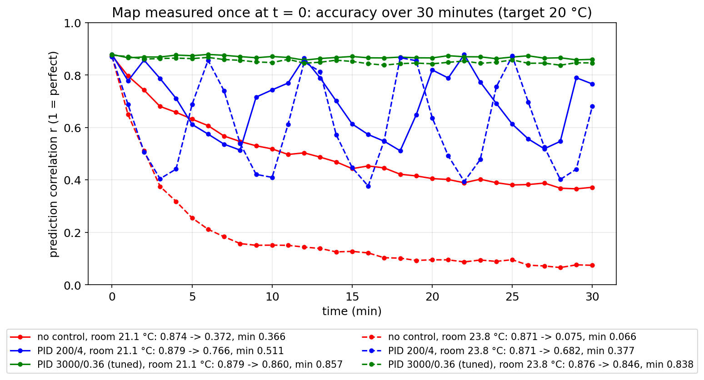
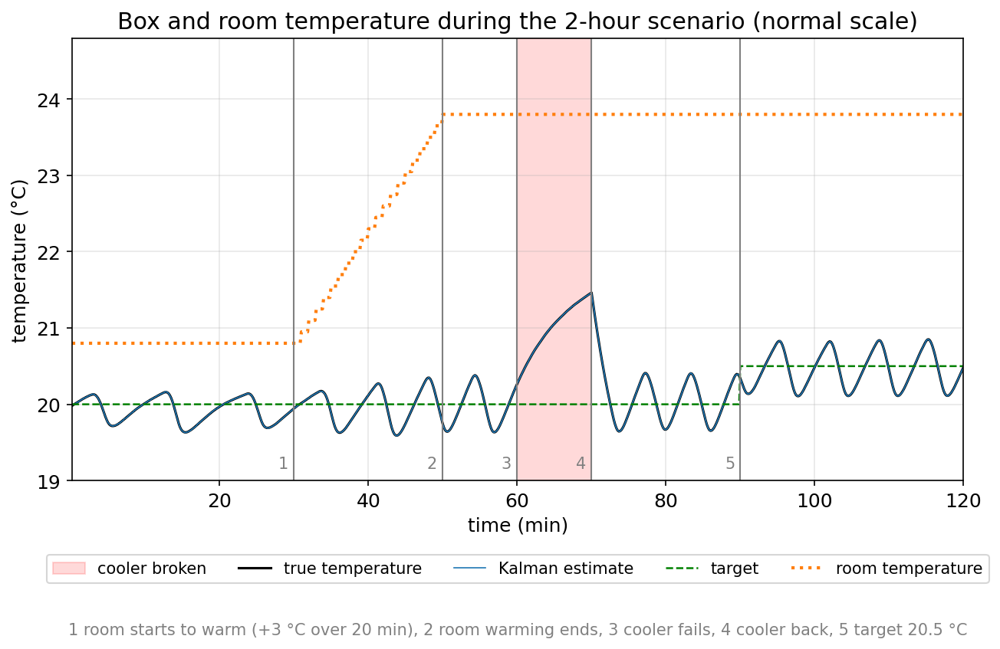
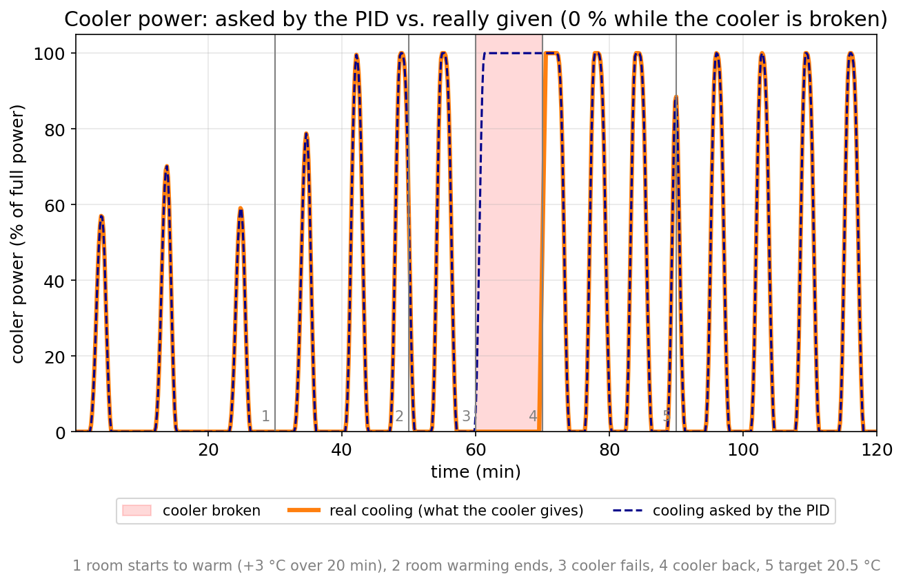
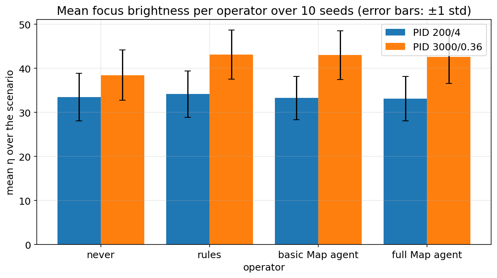
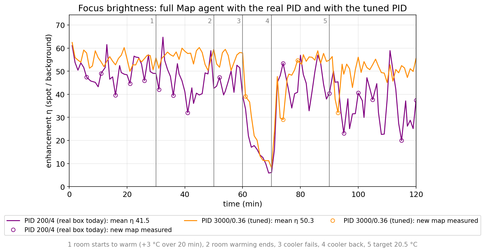
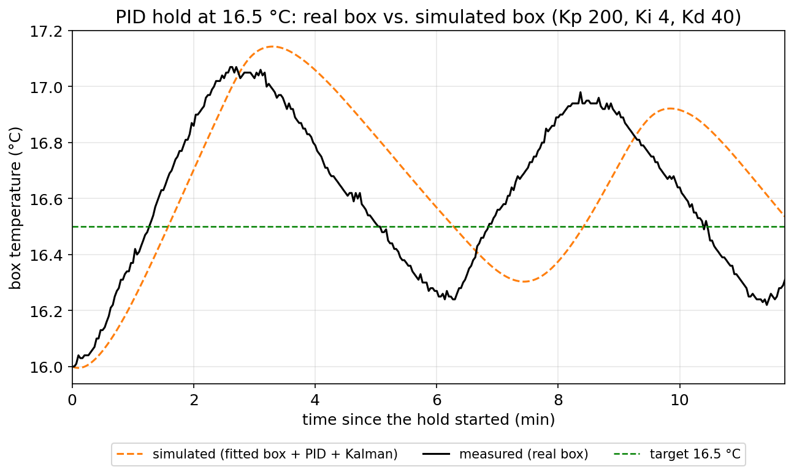

# Scattering-sample optics simulation

by Razmik Avagyan

Goal: a full simulation of the experiment as a base for AI agents that run and supervise it, later on the real setup.

This project simulates light passing through a phase-only SLM (N squares) and a strongly
scattering sample, with a camera recording intensities at M points. The sample is a random
complex transmission matrix X, using the row convention `E_out = E_in @ X`,
`(L x M) = (L x N) @ (N x M)`. The camera only sees `I = |E_out|**2`, so the generalized
Gerchberg-Saxton (GGS) algorithm recovers X from the known patterns and measured intensities.
The recovered map is then tested by focusing light through the sample and under temperature drift.

## Layout

- `config.py` — all numbers live in config.py: every tunable setting, one dict per module (`OPTICS`, `MAIN`, `DRIFT_TEST`, `THERMOSTAT`, `LAB_API`, `SCENARIO`, `BASELINE`, `STATE`, `AGENT_LOOP`, `WATCHDOG`, `SAFETY`, `PREDICTION`, `AI_BRAIN`, `REAL_BOX`, `FIT_REAL_BOX`), plus `TARGET_C`, with their sources.
- `env.py` — reads the local `.env` file (API keys and the lab addresses `BOX_URL`, `ROOM_URL`) into the environment; `config.py` calls it first. `.env` is never committed; `.env.example` lists the names.
- `optics_simulation/`
  - `lab.py` — the fake lab: random transmission matrix, 8-bit SLM patterns, SLM phase error, laser flicker, camera with noise/bit depth/saturation, the slow random drift `drift_step`, the temperature model `TemperatureSample`, and `FakeLab`. `TemperatureSample` is exactly X0 at `OPTICS["T_ref_C"]` (a property of the sample, never changed by `set_target`); the field correlation of the sample at two temperatures depends only on their difference, exp(−|T1 − T2|/T_c) with T_c = 1.6 °C. It is an AR(1) chain on a 0.02 °C grid built outward from T_ref in both directions (going up and going down give different samples), seeded per grid point, interpolated between points and extended lazily to any temperature.
  - `ggs.py` — GGS recovery of X from E_in and amplitudes, with restarts for stuck columns (`recover`).
  - `metrics.py` — focusing enhancement vs. theory (`focus_test`), correlation with the true map (`map_quality`, simulation only), and lab-usable speckle correlations (`pearson`, `prediction_correlation`, `output_correlation`).
- `box_simulation/`
  - `thermostat.py` — the temperature-controlled box: two-node thermal model (box air + walls and contents) with a delayed cooler, fitted to the real box; BME280 sensor with noise and rare spikes, Kalman filter and the real PID (Kp 200, Ki 4, Kd 40 at 20 Hz) (`simulate`). Room 20.8 °C and heat disturbance (0.54 W) from the real test. The real PID swings, so the self-test checks the swing (period, ±0.5 °C, ±`swing_band_C` = 0.4 °C after a step or a cooler failure) and prints the share of time within the thesis limit ±0.03 °C. The step test (back inside ±0.4 °C within 10 min) is asserted for the tuned PID 3000/0.36; the real PID 200/4 needs 22 min and is printed as expected to fail.
- `analysis/plots.py` — plotting functions only; each saves a PNG.
- `analysis/fit_real_box.py` — fits the box model to the real box test of 2026-11-18 (rest, full cooling, warm-up; the PID hold is the check), measures the sensor noise, estimates the heat disturbance from the rest-phase residual and compares the real and simulated PID swing; writes results/real_box/fit/.
- `experiments/`
  - `main.py` — one full simulated experiment (fake lab → GGS → checks → plots and data, settings in `SETTINGS`).
  - `compare.py` — never, rules, the basic and the full Map agent (rules brain, fresh level on) over seeds 0–9, each with the box PID of today and the refined PID; mean ± std per operator and PID, paired differences marked real only if larger than 2 standard errors (else "no clear difference"); runs in parallel (multiprocessing); writes results/compare/ (results.csv and the mean-η plot).
  - `drift_test.py` — 5-minute temperature drift test with and without temperature control, each with its map measured at t = 0 at the box temperature then; the box temperatures come from `box_simulation.thermostat`. The self-test runs it at 20 °C and 19 °C (only inside the test; above about 20.9 °C the box settles without cooling and the PID does nothing), each with the real PID 200/4 and the tuned PID (`PID_TUNING["refined"]`); the limits (with control: min > 0.75, end > 0.80) are asserted for the tuned PID and only printed for 200/4, which is expected to fail them (it swings ±0.3 °C). A long test (30 min, one map at t = 0) compares no control, PID 200/4 and the tuned PID in the two rooms of `PID_TUNING["holds"]` (21.1 and 23.8 °C, as `T_room` overrides) and writes `05_long_test_map_accuracy.png`; in the 23.8 °C room the tuned PID must end at least `long_margin` above no control.
- `agents/`
  - `lab_api.py` — `LabAPI`, the one door the future agents use: wait, read the thermometer, set the box target or control, measure/check a map and focus, all on one lab clock with a log.
  - `scenario.py` — timed world events the operator cannot see (warmer room, cooler failure, new target), run by `LabAPI`; the self-test runs 2 hours with no operator and writes results/scenario/.
  - `baseline.py` — a simple operator with fixed rules ("never" re-measure vs. "rules": check the map every 5 min, re-measure below 0.8, warn when the box is outside target ± `swing_band_C`), to compare the agents against later; writes results/baseline/.
  - `state.py` — `LabState`, the shared lab database (a local SQLite file, built-in `sqlite3`): runs, thermometer readings (never the true temperature), maps, focus photos, actions and notes, written by `LabAPI` and read by the agents.
  - `loop.py` — the agent loop Monitor → Diagnose → Plan → Act → Verify and a first Map agent with simple rules (re-measure only when the map is stale and the box is stable, i.e. inside target ± `swing_band_C` for 2 min; the summary also shows the share of time within ±0.03 °C); `plan()` asks the brain chosen in `AI_BRAIN["provider"]`; the self-test compares never, rules, the agent with the rules brain and with the fake brain (and with a real AI if its key is found); writes results/agents/.
  - `brain.py` — the brains of the Map agent: `RulesBrain` (the simple rules), `AIBrain(provider)` (Claude, Gemini or OpenAI over plain HTTPS with `urllib`, answering only JSON `{"actions": [...], "reason": "..."}`) and `FakeBrain` (no network, answers the rules plan as JSON, for tests). On a missing key, a failed or timed-out call, bad JSON or an action outside `ALLOWED`, the rules decide that loop and a warning note "brain fallback: <why>" is written; every AI decision writes a note "plan (<provider>): <actions> because <reason>". `load_env()` reads the API keys from `.env`.
  - `watchdog.py` — `Watchdog`: plain-code alarms read only from the lab database every step (box off target, temperature moved since the map (mean Kalman over one swing period, quiet after a target change), cooler at full power while the box still warms above the band, sensor stuck, focus dropped); an alarm wakes the Map agent at once, at most once per `alarm_cooldown_s`.
  - `safety.py` — `SafetyCheck`: reviews every plan (rules or AI) before `act()`: no `measure_map` on a moving box, sooner than `min_map_gap_s` after the last one or beyond `max_map_time_per_hour_s`, and no `wait` during a watchdog alarm; a fully refused AI plan is replaced by the (reviewed) rules plan.
  - `predict.py` — `MapPredictor`: fits check = c0·exp(-(dT/T_c)²) (c0 ≈ 0.86, the check of a fresh map) to the (dT, check_map) pairs in the database (dT from Kalman readings) and lets the agent skip `check_map` when the prediction is clearly above the threshold; after `max_bad` bad predictions it always checks.
  The three helpers are switched in `AGENT_LOOP` (`use_watchdog`, `use_safety`, `use_prediction`); all off gives the basic Map agent, all on the full Map agent.
  Stale rule (`AGENT_LOOP["use_fresh_level"]`, on by default, for the basic and the full Map agent): the "fresh level" is the median verify check of the last `fresh_n` new maps (until then `BASELINE["check_threshold"]`); the map is stale below `stale_share` × fresh level. If a new map does not verify at least `min_gain` better than the check before it, the agent waits twice as long before the next re-measure (up to `max_backoff_s`, note "map stale but a new map would not be better, backing off <s> s"); a map that helps resets the wait. The predictor skips a check only above this stale limit + margin, and the AI prompt gets the stale limit, fresh level and back-off.
  The `agents.loop` self-test compares never / rules / basic / full Map agent with the fixed 0.8 rule and with the fresh level, each with the box PID of today (THERMOSTAT, Kp 200, Ki 4) and with the refined PID from the tuning (`PID_TUNING["refined"]`, Kp 3000, Ki 0.36), passed only as an override (`box_settings`) for those runs.
- `real_lab/` — the real box (read-only, GET requests only):
  - `logger.py` — logs the EDO thermostat (`/api/status`) every 2 s and the lab room (`biglab`) every 60 s to results/real_box/test_<date>_<time>.csv.
  - `plot_test.py` — plots one logged CSV (box, target, room, probe, cooler power, target changes) as a PNG next to it.
- `results/` — generated plots and data.

## Running

Install: `pip install -r requirements.txt`. Run everything from the project root:

    python -m env                          # self-test of the .env reader
    python -m optics_simulation.lab        # self-test
    python -m optics_simulation.ggs        # self-test
    python -m optics_simulation.metrics    # self-test
    python -m box_simulation.thermostat    # self-test, writes results/thermostat/
    python -m analysis.plots               # self-test, temporary files only
    python -m experiments.main             # writes results/main/
    python -m experiments.drift_test       # writes results/drift_test/
    python -m experiments.compare          # self-test, 2 seeds, temporary files only
    python -m experiments.compare full     # 10 seeds x 2 PIDs x 4 operators, writes results/compare/
    python -m agents.lab_api               # self-test, a short lab story (no files)
    python -m agents.scenario              # 2-hour scenario without operator, writes results/scenario/
    python -m agents.baseline              # fixed-rule operator vs. doing nothing, writes results/baseline/ and results/lab_state.sqlite
    python -m agents.state                 # self-test of the lab database (temporary file)
    python -m agents.brain                 # self-test of the brains, fallbacks and load_env (no network)
    python -m agents.watchdog              # self-test of the alarms on made-up database rows
    python -m agents.safety                # self-test of the plan refusals
    python -m agents.predict               # self-test of the map-quality fit on made-up data
    python -m agents.loop                  # never vs. rules vs. basic / full Map agent, writes results/agents/

AI brain: copy `.env.example` to `.env` in the project root and fill in the key of the provider you use
(`ANTHROPIC_API_KEY`, `GEMINI_API_KEY` or `OPENAI_API_KEY`). `.env` is in `.gitignore` and must never be committed;
keys are never printed. Choose the brain with `AI_BRAIN["provider"]` in config.py (`"fake"` by default, needs no
internet; `"rules"` gives the old rules notes).

Real box (the Mac must be on the lab Wi-Fi; set `BOX_URL` and `ROOM_URL` in `.env` first; stop the logger with Ctrl+C):

    python -m real_lab.logger                                        # writes results/real_box/test_<date>_<time>.csv
    python -m real_lab.plot_test results/real_box/test_<date>_<time>.csv   # saves the .png next to the CSV
    python -m analysis.fit_real_box                                  # fit the box model to the real test, writes results/real_box/fit/

## Results

Drift model: the sample at temperature T is `lab.TemperatureSample`, and the similarity of the sample at two
temperatures depends only on their difference, exp(−|T1 − T2| / 1.6 °C). The earlier model depended on the distance
from 20 °C, so 19.6 °C and 20.4 °C gave almost the same sample and the map "came back" whenever the box passed 20 °C;
that hid the effect of the ±0.3 °C swing of the real PID (Kp 200, Ki 4). With the new model the swing alone makes a
map partly stale within minutes, so all numbers below are lower than before the fix.

How well the map, measured at t = 0, predicts the camera over 5 minutes, without and with temperature control
(real PID 200/4; with the tuned PID 3000/0.36 the map stays at 0.86 or better, see `python -m experiments.drift_test`):

The longer test: one map at t = 0, 30 minutes, in the 21.1 °C and 23.8 °C rooms. Without control the map is lost
(end 0.37 and 0.08); the real PID 200/4 swings, so the map comes and goes with the swing (between 0.38 and 0.88);
the tuned PID keeps the box within 0.02 to 0.04 °C and the map at 0.85 or better for the whole 30 minutes:

The focus spot at the start and after 5 minutes, without and with temperature control:

The 2-hour scenario with no operator (the room warms, the cooler fails for 10 minutes, a new target):

Cooler power during the scenario, asked by the PID and really given:

### The Map agent

The Map agent (Monitor → Diagnose → Plan → Act → Verify) checks the map and re-measures it when it is stale; the basic
Map agent uses the rules alone, the full Map agent adds a watchdog, a safety check of every plan and a map-quality prediction; both use the
"fresh level" stale rule with back-off. The brain can be the rules or an AI (Claude, Gemini, OpenAI) that falls back
to the rules on any error. Over 10 seeds (`python -m experiments.compare full`, differences real only beyond
2 standard errors):

- Tuned PID (Kp 3000, Ki 0.36, from the PID tuning) instead of the real 200/4: about +9 mean η for every operator
  (never +5), and 0.69 instead of 0.07 of the time within ±0.03 °C. Better temperature control helps far more than
  any agent logic.
- Agents vs. fixed rules on η: no clear difference with the tuned PID; with the real PID the agents are about 1 η
  lower (they re-measure maps that soon go stale again).
- The agents notice the cooler failure 2.5 to 3 minutes sooner than the fixed rules (121 / 99 s vs. 277 s after
  the failure with the real PID).

The full Map agent during the scenario with the real PID and with the tuned PID (seed 0):

The box model fitted to the real box test (C fixed; fit RMS 0.026 °C; the PID hold was not fitted and is the check):

The real PID hold at 16.5 °C and the simulated one with the fitted box (swing period 5.5 min measured, 5.1 to 5.7 min simulated):

