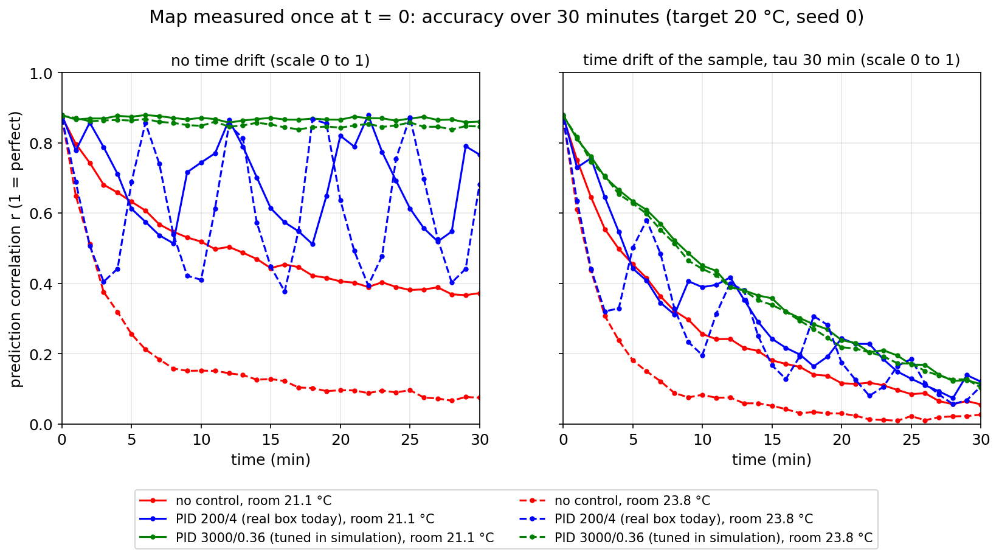
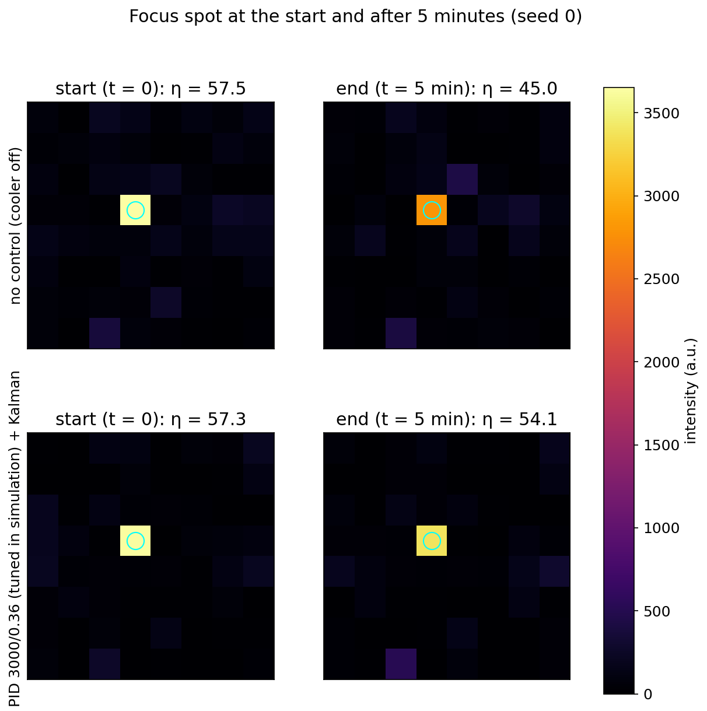
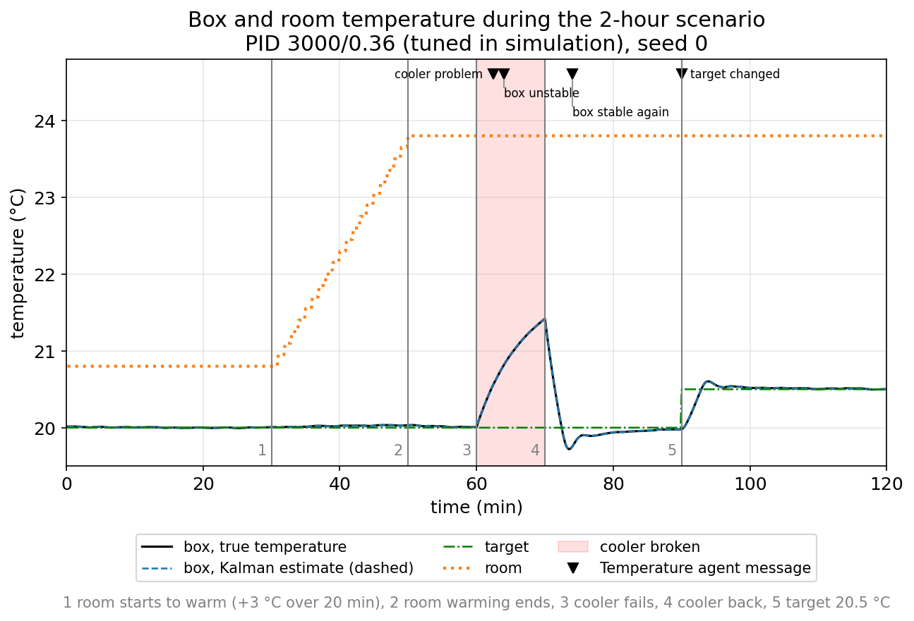
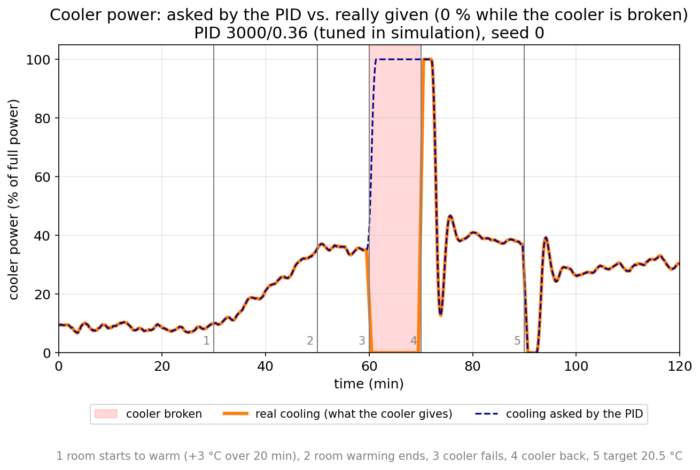
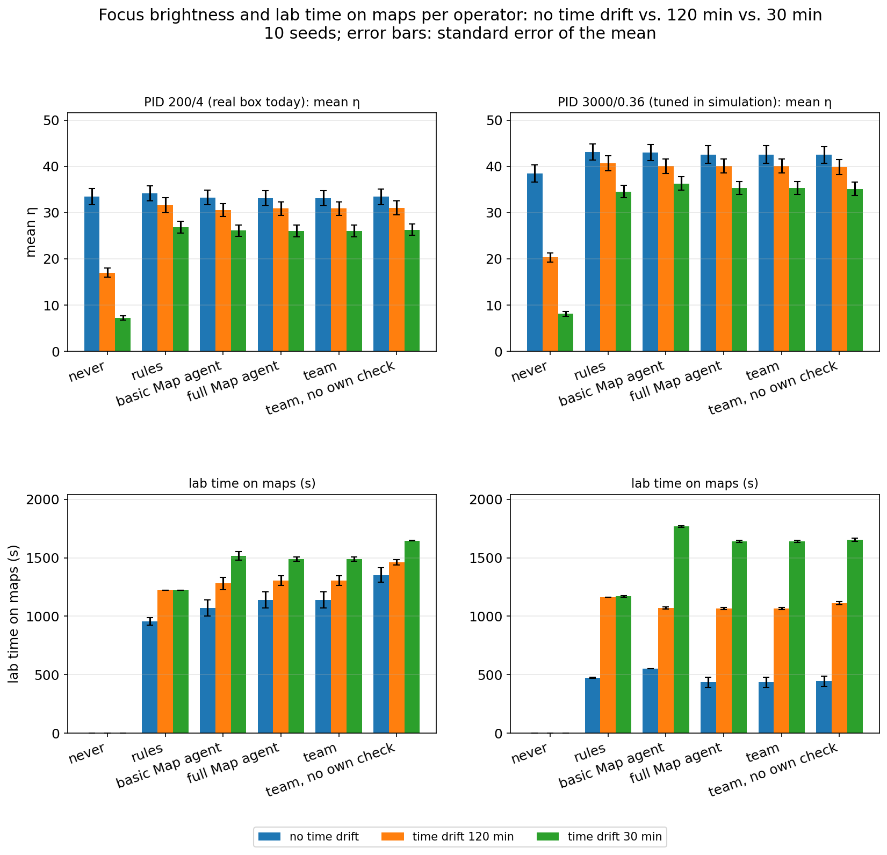
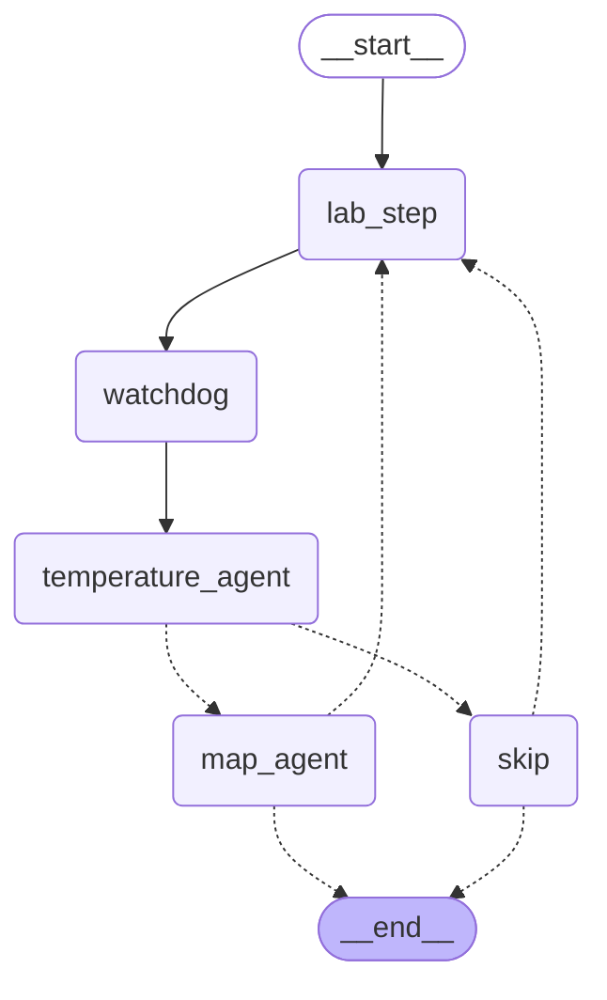
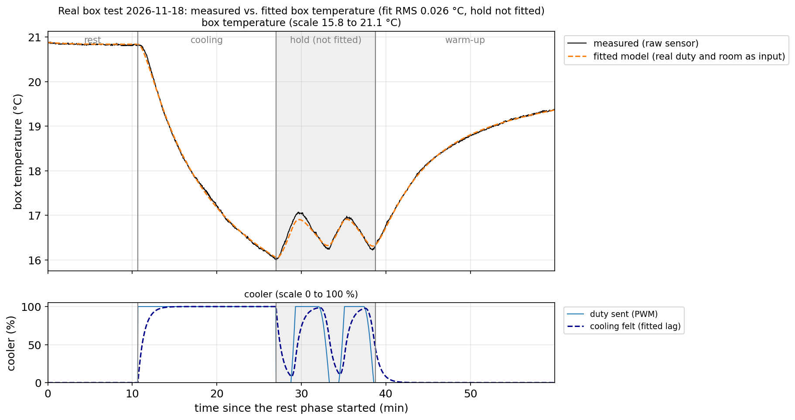

# Scattering-sample optics simulation

by Razmik Avagyan

Goal: a full simulation of the experiment as a base for AI agents that run and supervise it, later on the real setup.

This project simulates light passing through a phase-only SLM (N squares) and a strongly
scattering sample, with a camera recording intensities at M points. The sample is a random
complex transmission matrix X, using the row convention `E_out = E_in @ X`,
`(L x M) = (L x N) @ (N x M)`. The camera only sees `I = |E_out|**2`, so the generalized
Gerchberg-Saxton (GGS) algorithm recovers X from the known patterns and measured intensities.
The recovered map is then tested by focusing light through the sample and under temperature drift.

## Layout

- `config.py` — all numbers live in config.py: every tunable setting, one dict per module (`OPTICS`, `MAIN`, `DRIFT_TEST`, `THERMOSTAT`, `LAB_API`, `SCENARIO`, `BASELINE`, `STATE`, `AGENT_LOOP`, `WATCHDOG`, `SAFETY`, `PREDICTION`, `AI_BRAIN`, `REAL_BOX`, `FIT_REAL_BOX`), plus `TARGET_C`, with their sources.
- `env.py` — reads the local `.env` file (API keys and the lab addresses `BOX_URL`, `ROOM_URL`) into the environment; `config.py` calls it first. `.env` is never committed; the names it needs are listed under Running.
- `optics_simulation/`
  - `lab.py` — the fake lab: random transmission matrix, 8-bit SLM patterns, SLM phase error, laser flicker, camera with noise/bit depth/saturation, the slow random drift `drift_step`, the temperature model `TemperatureSample`, and `FakeLab`. `TemperatureSample` is exactly X0 at `OPTICS["T_ref_C"]` (a property of the sample, never changed by `set_target`); the field correlation of the sample at two temperatures depends only on their difference, exp(−|T1 − T2|/T_c) with T_c = 1.6 °C. It is an AR(1) chain on a 0.02 °C grid built outward from T_ref in both directions (going up and going down give different samples), seeded per grid point, interpolated between points and extended lazily to any temperature.
  - `ggs.py` — GGS recovery of X from E_in and amplitudes, with restarts for stuck columns (`recover`).
  - `metrics.py` — focusing enhancement vs. theory (`focus_test`), correlation with the true map (`map_quality`, simulation only), and lab-usable speckle correlations (`pearson`, `prediction_correlation`, `output_correlation`).
- `box_simulation/`
  - `thermostat.py` — the temperature-controlled box: two-node thermal model (box air + walls and contents) with a delayed cooler, fitted to the real box; BME280 sensor with noise and rare spikes, Kalman filter and the real PID (Kp 200, Ki 4, Kd 40 at 20 Hz) (`simulate`). Room 20.8 °C and heat disturbance (0.54 W) from the real test. The real PID swings, so the self-test checks the swing (period, ±0.5 °C, ±`swing_band_C` = 0.4 °C after a step or a cooler failure) and prints the share of time within the thesis limit ±0.03 °C. The step test (back inside ±0.4 °C within 10 min) is asserted for the tuned PID 3000/0.36; the real PID 200/4 needs 22 min and is printed as expected to fail.
- `analysis/plots.py` — plotting functions only; each saves a PNG.
- `analysis/fit_real_box.py` — fits the box model to the real box test of 2026-11-18 (rest, full cooling, warm-up; the PID hold is the check), measures the sensor noise, estimates the heat disturbance from the rest-phase residual and compares the real and simulated PID swing; writes results/real_box/fit/.
- `experiments/`
  - `main.py` — one full simulated experiment (fake lab → GGS → checks → plots and data, settings in `SETTINGS`).
  - `compare.py` — never, rules, the basic and the full Map agent (rules brain, fresh level on), the team, and the team without the Map agent's own stability check ("team, no own check") over seeds 0–9, each with the box PID of today and the main PID (`PLOTS["main_pid"]`), and (full run) for each time drift setting in `COMPARE["time_drift_taus"]` (none, 120 min, 30 min); mean ± std per operator and PID, paired differences marked real only if larger than 2 standard errors (else "no clear difference"); also counts new maps and checks started while the box was outside target ± `swing_band_C`; runs in parallel (multiprocessing); writes results/compare/ (`results<tag>.csv` and `.txt` per time drift setting, the bar plots 01 and 02).
  - `drift_test.py` — 5-minute temperature drift test with and without temperature control, each with its map measured at t = 0 at the box temperature then; the box temperatures come from `box_simulation.thermostat`. The self-test runs it at 20 °C and 19 °C (only inside the test; above about 20.9 °C the box settles without cooling and the PID does nothing), each with the real PID 200/4 and the tuned PID (`PID_TUNING["refined"]`); the limits (with control: min > 0.75, end > 0.80) are asserted for the tuned PID and only printed for 200/4, which is expected to fail them (it swings ±0.3 °C). A long test (30 min, one map at t = 0) compares no control, PID 200/4 and the tuned PID in the two rooms of `PID_TUNING["holds"]` (21.1 and 23.8 °C, as `T_room` overrides) without and with time drift of the sample (τ 30 min), and writes `02_long_test_map_accuracy.png` (two panels); in the 23.8 °C room the main PID must end at least `long_margin` above no control. Plot 01 is the focus spot at the start and the end of the 5-minute test.
- `agents/` — in five subpackages: `core/` (lab interface, permissions, lab database, human in the loop, brains), `map_agent/` (the Map agent loop and its watchdog, safety check, predictor and staleness forms), `temperature/` (the Temperature agent), `team/` (team graph, scenario events, fixed-rule baseline), `reporting/` (data analyst, Scientist):
  - `core/lab_api.py` — `Lab`, the interface every lab provides (`wait`, `clock`, `get_temperature`, `get_status`, `set_target`, `set_control`, `measure_map`, `check_map`, `focus`, `note`, `actor`, `run_id`, plus `truth()` for plots), and `SimLab` (old name `LabAPI`), the simulated lab: all on one lab clock with a log. `LabError` is a hardware error.
  - `core/safe_lab.py` — `SafeLab(lab, actor)`: the permissions in one place, used by every agent (and later the MCP server). See "The lab interface, permissions and the human" below.
  - `core/human.py` — the human in the loop: a LangGraph interrupt before the act node of every agent (`HUMAN["mode"]`).
  - `team/scenario.py` — timed world events the operator cannot see (warmer room, cooler failure, new target), run by `LabAPI`; the self-test runs 2 hours with no operator and writes results/scenario/.
  - `team/baseline.py` — a simple operator with fixed rules ("never" re-measure vs. "rules": check the map every 5 min, re-measure below 0.8, warn when the box is outside target ± `swing_band_C`), to compare the agents against later; writes results/baseline/ (numbers only: results.csv and summary.json, with the main PID).
  - `core/state.py` — `LabState`, the shared lab database (a local SQLite file, built-in `sqlite3`): runs, thermometer readings (never the true temperature), maps, focus photos, actions, notes and the messages between agents, written by `LabAPI` and read by the agents.
  - `map_agent/loop.py` — the agent loop Monitor → Diagnose → Plan → Act → Verify, built as a LangGraph graph with one node per phase (the simulation clock and the database stay outside the graph), and a first Map agent with simple rules (re-measure only when the map is stale and the box is stable, i.e. inside target ± `swing_band_C` for 2 min; the summary also shows the share of time within ±0.03 °C); `plan()` asks the brain chosen in `AI_BRAIN["provider"]`; the self-test compares never, rules, the agent with the rules brain and with the fake brain (and with a real AI if its key is found); writes results/agents/.
  - `temperature/temperature_agent.py` — the Temperature agent, a LangGraph subgraph (monitor → diagnose → plan → safety check → act → verify, rules brain). It owns the box but only reads the thermometer rows, the room temperature and the watchdog alarms; it sends the Map agent "box unstable", "cooler problem", "box stable again", "target changed" and "target too close to room", each once per event. It may only wait, send messages and switch the PID back on (never off, never the target).
  - `team/team.py` — the team graph (LangGraph), one tick = one step: lab step → watchdog → Temperature agent → "task due?" → task agent or skip → "end of run?". It knows nothing about optics: the task is any object with `name`, `on_step`, `alarms`, `due`, `run_loop`, `record`; today it is the Map agent (`loop.MapTask`, put together with the lab in `loop.run_team`). With `AGENT_LOOP["use_messages"]` off the team gives exactly the full Map agent's numbers. With `AGENT_LOOP["own_stability_check"]` False (only allowed with `use_messages`) the Map agent does not compute "stable" from the thermometer rows: the box counts as stable unless a "box unstable" or "cooler problem" message is open, and while one is open it retries as for a moving box. A hardware error in a tick writes a warning note, puts the lab in its safe state (control on, target kept) and skips the tick; after `LAB_LIMITS["max_errors"]` errors the run stops cleanly and keeps what was recorded.
  - `reporting/data_analyst.py` — the data analyst agent: after every run (`loop.run`, and the `data_analyst` node of the team graph after the last tick; switch `AGENT_LOOP["use_analyst"]`) it reads only the lab database and writes findings (kind, one plain sentence, value, unit, evidence) to the `findings` table and to `results/analysis/<run name>.json` and `.md`. The analyses are plain code and LangChain tools: temperature (time within ±0.03 °C and the band, largest deviation, periods outside the band), events (cooler failure and target change as seen in the data, first agent reaction, time back in the band), lab time (measure_map, check_map, focus, waiting, wasted), agents (alarms, messages, refusals, warnings, AI fallbacks), and the task-specific map staleness (T_c and c0 fitted with uncertainties, focus brightness before and after each new map). `analyze_runs` compares groups of runs (mean ± standard error, differences beyond 2 standard errors). Its brain is chosen like the Map agent's: the rules run every tool that has data; an AI picks the tools (at most `analyst_max_tool_calls`) and writes the text, and every number in its text must match a tool result, otherwise the rules text is used with a warning note.
  - `reporting/scientist.py` — the Scientist agent (LangGraph: read → questions → plan → run → check → write): reads all saved results (analyst reports, comparisons, drift test, main, real-box fit, thermostat summary), picks open questions, runs a few extra comparisons from a whitelist within a fixed budget (`SCIENTIST` in config.py), and writes `results/report/report.md` and `report.json`. Code computes every number; every sentence cites source ids and is dropped if a number does not match them.
  - `core/brain.py` — the brains of the Map agent: `RulesBrain` (the simple rules), `AIBrain(provider)` (Claude, Gemini or OpenAI through LangChain chat models with structured output, answering only JSON `{"actions": [...], "reason": "..."}`) and `FakeBrain` (no network, answers the rules plan as JSON, for tests). On a missing key, a failed or timed-out call, bad JSON or an action outside `ALLOWED`, the rules decide that loop and a warning note "brain fallback: <why>" is written; every AI decision writes a note "plan (<provider>): <actions> because <reason>". `load_env()` reads the API keys from `.env`.
  - `map_agent/watchdog.py` — `Watchdog`: plain-code alarms read only from the lab database every step (box off target, temperature moved since the map (mean Kalman over one swing period, quiet after a target change), cooler at full power while the box still warms above the band, sensor stuck, focus dropped); an alarm wakes the Map agent at once, at most once per `alarm_cooldown_s`.
  - `map_agent/safety.py` — `SafetyCheck`: reviews every plan (rules or AI) before `act()`: no `measure_map` on a moving box, sooner than `min_map_gap_s` after the last one or beyond `max_map_time_per_hour_s`, and no `wait` during a watchdog alarm; a fully refused AI plan is replaced by the (reviewed) rules plan.
  - `map_agent/predict.py` — `MapPredictor`: fits check = c0·exp(-(dT/T_c)²) (c0 ≈ 0.86, the check of a fresh map) to the (dT, check_map) pairs in the database (dT from Kalman readings) and lets the agent skip `check_map` when the prediction is clearly above the threshold; after `max_bad` bad predictions it always checks. With `PREDICTION["form"]` it can use another staleness form (default `"gaussian"`, the form above, so every number stays as before; `"auto"`: the form the data analyst chose for the same PID and time drift, from `results/analysis/staleness_forms.json`).
  - `map_agent/staleness.py` — the staleness formula chosen from the data (plain code): exponential c0·exp(−2dT/T_c), Gaussian c0·exp(−(dT/T_c)²), stretched c0·exp(−(dT/T_c)^β) with β fitted in 0.5–3, and each times exp(−dt/τ) (dt = time since the map) when at least `time_min_points` checks spread over `time_min_spread_s`. Every form gets a leave-one-out prediction error; the choice is the lowest n·ln(MSE) + 2 per parameter (AIC-like); fewer than `min_points` checks: no choice. The data analyst reports every form and the choice as findings and remembers the choice per setup.
  The three helpers are switched in `AGENT_LOOP` (`use_watchdog`, `use_safety`, `use_prediction`); all off gives the basic Map agent, all on the full Map agent.
  Stale rule (`AGENT_LOOP["use_fresh_level"]`, on by default, for the basic and the full Map agent): the "fresh level" is the median verify check of the last `fresh_n` new maps (until then `BASELINE["check_threshold"]`); the map is stale below `stale_share` × fresh level. If a new map does not verify at least `min_gain` better than the check before it, the agent waits twice as long before the next re-measure (up to `max_backoff_s`, note "map stale but a new map would not be better, backing off <s> s"); a map that helps resets the wait. The predictor skips a check only above this stale limit + margin, and the AI prompt gets the stale limit, fresh level and back-off.
  The `agents.map_agent.loop` self-test compares never / rules / basic / full Map agent with the fixed 0.8 rule and with the fresh level, each with the box PID of today (THERMOSTAT, Kp 200, Ki 4) and with the refined PID from the tuning (`PID_TUNING["refined"]`, Kp 3000, Ki 0.36), passed only as an override (`box_settings`) for those runs.
- `mcp_server/` — `server.py`, the MCP server of the lab (see "The MCP server" below).
- `real_lab/` — the real box:
  - `lab.py` — `RealLab`, the real box behind the same lab interface: thermometer, status, target and control through the box web API (`BOX_URL`), the room from `ROOM_URL`, the wall clock for `wait`; the SLM and camera methods raise `NotImplementedError("needs the real SLM/camera")` for now. Its self-test uses a stand-in web server on 127.0.0.1 and never contacts the box.
  - `logger.py` — logs (read-only, GET requests only) the EDO thermostat (`/api/status`) every 2 s and the lab room (`biglab`) every 60 s to results/real_box/test_<date>_<time>.csv.
  - `plot_test.py` — plots one logged CSV (box, target, room, probe, cooler power, target changes) as a PNG next to it.
- `results/` — generated plots and data.

## Running

Install: `pip install -r requirements.txt` (numpy, matplotlib, and LangChain / LangGraph for the AI brain and the agent graph; `cryptography` is pinned to 48.0.1, the newest with a ready wheel for Intel Macs). Run everything from the project root:

    python -m env                                   # self-test of the .env reader
    python -m optics_simulation.lab                 # self-test
    python -m optics_simulation.ggs                 # self-test
    python -m optics_simulation.metrics             # self-test
    python -m box_simulation.thermostat             # self-test, writes results/thermostat/
    python -m analysis.plots                        # self-test, temporary files only
    python -m experiments.main                      # writes results/main/
    python -m experiments.drift_test                # writes results/drift_test/
    python -m experiments.compare                   # self-test, 2 seeds, temporary files only
    python -m experiments.compare full              # 10 seeds x 2 PIDs x 6 operators, for each time drift setting; writes results/compare/
    python -m experiments.compare forms             # predictor form "gaussian" vs "auto", basic and full Map agent; writes results/compare/forms.*
    python -m agents.core.lab_api                   # self-test, a short lab story (no files)
    python -m agents.core.safe_lab                  # self-test of every permission and limit (stand-in lab)
    python -m agents.core.human                     # self-test of the human modes (scripted approvers, in-memory database)
    python -m real_lab.lab                          # self-test of RealLab with a stand-in web server (no network)
    python -m mcp_server.server --test              # MCP server self-test: every tool in-process, simulated lab, no network
    python -m agents.team.scenario                  # 2-hour scenario without operator, writes results/scenario/
    python -m agents.team.baseline                  # fixed-rule operator vs. doing nothing, writes results/baseline/ and results/lab_state.sqlite
    python -m agents.core.state                     # self-test of the lab database (temporary file)
    python -m agents.core.brain                     # self-test of the brains, fallbacks and load_env (no network)
    python -m agents.map_agent.watchdog             # self-test of the alarms on made-up database rows
    python -m agents.map_agent.safety               # self-test of the plan refusals
    python -m agents.map_agent.predict              # self-test of the map-quality fit on made-up data
    python -m agents.map_agent.staleness            # self-test: the form choice on made-up data and on simulated runs
    python -m agents.temperature.temperature_agent  # self-test: each message once, none on a normal hold, never off
    python -m agents.team.team                      # team graph: made-up task, then Temperature + Map agent; writes results/agents/team_graph.mmd
    python -m agents.reporting.data_analyst         # self-test: findings of a team run (both PIDs), fake-brain checks
    python -m agents.reporting.scientist --test     # Scientist self-test with a fake brain (temporary files only)
    python -m agents.reporting.scientist            # the Scientist's report, writes results/report/ (rules brain without an API key)
    python -m agents.map_agent.loop                 # never vs. rules vs. basic / full Map agent, writes results/agents/

`.env`: create it in the project root, one `NAME=value` line each, only the names you use (it is in `.gitignore` and
must never be committed; keys and addresses are never printed):

    ANTHROPIC_API_KEY=   # Claude, for the AI brain
    GEMINI_API_KEY=      # Gemini, for the AI brain
    OPENAI_API_KEY=      # OpenAI, for the AI brain
    BOX_URL=             # the box status JSON on the lab network (real_lab/logger.py, real_lab/lab.py)
    ROOM_URL=            # the room sensor JSON (the room temperature)

AI brain: fill in the key of the provider you use. Choose the brain with `AI_BRAIN["provider"]` in config.py (`"fake"` by default, needs no
internet; `"rules"` gives the old rules notes).

Real box (the Mac must be on the lab Wi-Fi; set `BOX_URL` and `ROOM_URL` in `.env` first; stop the logger with Ctrl+C):

    python -m real_lab.logger                                             # writes results/real_box/test_<date>_<time>.csv
    python -m real_lab.plot_test results/real_box/test_<date>_<time>.csv  # saves the .png next to the CSV
    python -m analysis.fit_real_box                                       # fit the box model to the real test, writes results/real_box/fit/

## The lab interface, permissions and the human

- **One interface, two labs.** Every lab implements `agents.core.lab_api.Lab`. `SimLab` is the simulation used by all tests
  and results; `real_lab.lab.RealLab` is the real box (thermometer, status, target and control through the box web
  API, room temperature from the room server, wall-clock `wait`; no SLM or camera yet). The agents use only the
  interface, so the same agents can run on either. The true temperature exists only on the simulated lab, through
  `truth()` (for plots and summaries, never for decisions); on the real lab it is None and the plots leave that line out.
  The write paths of the box web API (`REAL_BOX["target_path"]`, `["control_path"]`) are estimates: check them on the
  box web page before the first real run.
- **Permissions in one place.** Every agent reaches the lab through `SafeLab(lab, actor)`: the Map agent may wait, read,
  measure_map, check_map and focus; the Temperature agent may wait, read and switch the control on (never off); the
  operator may do everything. For everyone, the target stays within `LAB_LIMITS["target_min_C"]` .. `["target_max_C"]`
  (15 .. 30 °C) and a focus point inside the camera. A refused call writes a warning note and raises `PermissionError`.
  The agents' own safety checks stay as they are.
- **Target vs room.** The box can only cool. A new target above room − `LAB_LIMITS["room_margin_C"]` (0.5 °C) is allowed
  but writes a warning note, and the Temperature agent sends "target too close to room". If the room temperature is
  unknown, the check is skipped with a note.
- **Human in the loop.** `HUMAN["mode"]`: `"off"` (default, everything exactly as before), `"suggest"` (the agents only
  propose; every action waits for approval, nothing runs without it) or `"approve_big"` (only `set_target`,
  `set_control`, `measure_map` and anything an AI brain proposes that the rules would not wait; waits, checks, focus
  photos and messages go through). The agents' graphs stop before their act node (a LangGraph interrupt); in the
  terminal the human answers y/n within `HUMAN["timeout_s"]` (no answer = refused, the lab keeps its state). Every
  proposal, approval and refusal is a note with the actor "human". The per-step focus photo, the thermometer reads and
  the monitor's map check are observations, not planned actions, so they do not wait.

## The MCP server

`mcp_server/server.py` makes the lab available to any MCP client (Claude Desktop, Claude Code, ...) through the
official Python MCP SDK (`mcp`, its `MCPServer`, called FastMCP before SDK 2.x; stdio transport). The client can then
read and run the lab in plain language. One lab lives as long as the server: `MCP["lab"]` = `"sim"` (the simulated
lab, default; its time moves only with the actions and `wait`) or `"real"` (`RealLab`, needs `BOX_URL` in `.env`).
The simulated lab runs the PID `MCP["pid"]`: `"real"` (default, PID 200/4 as on the real box) or a `PID_TUNING` name
such as `"refined"` (PID 3000/0.36); the real lab ignores it.

- **Lab tools:** `get_temperature`, `get_status`, `get_log(last_n)`, `wait(seconds)` (at most `MCP["max_wait_s"]`,
  600 s), `set_target(T)`, `set_control(on)`, `measure_map`, `check_map`, `focus(point)`. Every one goes through
  `SafeLab` with the actor "mcp" and the role `MCP["role"]` (default "operator"): the same permissions, limits
  (target 15–30 °C, focus point inside the camera) and target vs room warning as for the agents. A refusal comes back
  as a clear error text. With `HUMAN["mode"]` "approve_big" or "suggest" the server asks y/n on its own terminal before
  the action (no terminal, as when Claude Desktop starts it, means refused); with "off" the MCP client's own
  approval prompt is the human check.
- **Read tools** (lab database, read-only): `list_runs`, `run_summary(run_name)` (mean η, lab time on maps, share of
  Kalman readings within ±0.03 °C, new maps and checks), `findings(run_name)` (the data analyst's findings),
  `messages(run_name)` (the Temperature agent's messages); the Scientist report is the resource
  `lab://scientist-report`.
- Every tool call writes a note with the actor "mcp" (tool, arguments, result or error) to the server's run
  (`MCP["run_name"]`) in `results/lab_state.sqlite`.

Start it by hand (it waits for an MCP client on stdin/stdout): `.venv/bin/python -m mcp_server.server`.

**Claude Desktop:** add to `claude_desktop_config.json` (Settings → Developer → Edit Config), with the absolute path
of your copy of the project in place of `/ABSOLUTE/PATH/TO/Box_Project`, then restart Claude Desktop:

```json
{
  "mcpServers": {
    "box-lab": {
      "command": "/ABSOLUTE/PATH/TO/Box_Project/.venv/bin/python",
      "args": ["-m", "mcp_server.server"],
      "cwd": "/ABSOLUTE/PATH/TO/Box_Project",
      "env": {"PYTHONPATH": "/ABSOLUTE/PATH/TO/Box_Project"}
    }
  }
}
```

**Claude Code** (from the project folder):

    claude mcp add box-lab -- /ABSOLUTE/PATH/TO/Box_Project/.venv/bin/python -m mcp_server.server

**Example questions:** "What is the box temperature and how far is it from the target?" · "Measure a map, wait 5
minutes, check it, and tell me how much it went stale." · "Focus on camera point 27 and report eta." · "Set the
target to 25 °C." (refused, or a warning if it is near the room) · "Which runs are in the lab database? Summarize
team_pid_3000_0.36." · "What did the Temperature agent tell the Map agent in the team run?" · "What does the
Scientist report say the agents add, and where not?"

## Settings for the plots and the sample

- **Main PID of the plots**: `PLOTS["main_pid"]` in config.py, a key of `PID_TUNING` (`"refined"` = PID 3000/0.36, tuned in simulation; `"first_search"` = PID 800/0.5, the first grid search, run on the real box in test 3). Plots that show one PID use it (agents 01, scenario 01 and 02, drift test 01); plots that compare PIDs show it next to PID 200/4, the real box today (thermostat 01, which also shows PID 800/0.5, thermostat 03, the long drift test 02, the comparison plot and agents 02). `THERMOSTAT` (200/4) is not changed. Setting `"first_search"` switches all of this to 800/0.5.
- **Time drift of the sample**: `OPTICS["time_drift_tau_min"]` (default `None` = off). Without it the sample depends only on the temperature, so an old map becomes good again whenever the box returns to the temperature of the map. With a value τ, every entry of the sample also turns by a slowly random-walking phase, so that the field correlation between the sample at (T1, t1) and (T2, t2) is about exp(−|T1 − T2|/T_c)·exp(−|t1 − t2|/τ); the size of every entry stays the same. The camera's check is an intensity correlation (about the square), so it falls like exp(−2|Δt|/τ).

## Results

Drift model: the sample at temperature T is `lab.TemperatureSample`, and the similarity of the sample at two
temperatures depends only on their difference, exp(−|T1 − T2| / 1.6 °C). The earlier model depended on the distance
from 20 °C, so 19.6 °C and 20.4 °C gave almost the same sample and the map "came back" whenever the box passed 20 °C;
that hid the effect of the ±0.3 °C swing of the real PID (Kp 200, Ki 4). With the new model the swing alone makes a
map partly stale within minutes, so all numbers below are lower than before the fix.

Over 5 minutes with one map from t = 0 (numbers in `results/drift_test/results.csv`), the tuned PID keeps the map at
0.86 or better, while without control it falls from 0.87 to 0.67.

The longer test: one map at t = 0, 30 minutes, in the 21.1 °C and 23.8 °C rooms. Without control the map is lost
(end 0.37 and 0.08); the real PID 200/4 swings, so the map comes and goes with the swing (between 0.38 and 0.88);
the tuned PID keeps the box within 0.02 to 0.04 °C and the map at 0.85 or better for the whole 30 minutes (left).
With time drift of the sample (τ = 30 min, right) the map is lost after about half an hour whatever the box does, so a
good thermostat alone is not enough:



The focus spot at the start and after 5 minutes, without and with temperature control:



The 2-hour scenario (the room warms, the cooler fails for 10 minutes, a new target): box, target and room temperature
on one panel, and below it the messages the Temperature agent sent in the team run (cooler problem, box unstable,
box stable again, target changed):



Cooler power during the scenario, asked by the PID and really given:



The Kalman filter (thermostat plot 03, PID 200/4 and PID 3000/0.36 side by side): the box temperature is the same
with the Kalman filter and on the raw sensor, because the box averages out the fast duty changes, but the cooler duty
is much calmer (bottom row: one minute with the cooler working): the std of the duty change per control step is 0.033
vs. 0.221 % with PID 200/4, 0.056 vs. 1.800 % with PID 800/0.5 and 0.147 vs. 4.909 % with PID 3000/0.36. With PID 200/4 the ±0.3 °C swing comes from the PID and the cooler delay, not from sensor noise, so the
Kalman filter does not remove it.


### The Scientist's report

`python -m agents.reporting.scientist` reads all saved results, asks a few open questions (without an API key, a fixed list:
does the full Map agent beat the fixed rules at time drift 30 min with PID 200/4; at which time drift do the agents
start to beat the rules; does the team differ from the full Map agent), runs up to three small extra comparisons
(at most 10 seeds each, 40 min in total), and writes [results/report/report.md](results/report/report.md): what was
simulated, the thermostat, optics and map staleness, the operators compared, what the agents add, the new experiments,
what must be measured on the real setup, and the limitations. Every sentence cites its sources and every number in it
is checked against them; sentences that fail the check are listed as dropped.

### The Map agent

The Map agent (Monitor → Diagnose → Plan → Act → Verify) checks the map and re-measures it when it is stale; the basic
Map agent uses the rules alone, the full Map agent adds a watchdog, a safety check of every plan and a map-quality prediction; both use the
"fresh level" stale rule with back-off. The brain can be the rules or an AI (Claude, Gemini, OpenAI) that falls back
to the rules on any error. Over 10 seeds (`python -m experiments.compare full`, differences real only beyond
2 standard errors):

- Tuned PID (Kp 3000, Ki 0.36, from the PID tuning) instead of the real 200/4: about +9 mean η for every operator
  (never +5), and 0.69 instead of 0.07 of the time within ±0.03 °C. Better temperature control helps far more than
  any agent logic.
- Agents vs. fixed rules on η: no clear difference with the tuned PID; with the real PID the agents are about 1 η
  lower (they re-measure maps that soon go stale again).
- The agents notice the cooler failure 2.5 to 3 minutes sooner than the fixed rules (121 / 99 s vs. 277 s after
  the failure with the real PID).

**With time drift of the sample** (`python -m experiments.compare full`, 10 seeds, mean η ± standard deviation; "real"
= paired difference beyond 2 standard errors):

| operator | 200/4, no drift | 200/4, τ 120 min | 200/4, τ 30 min | 3000/0.36, no drift | 3000/0.36, τ 120 min | 3000/0.36, τ 30 min |
|---|---|---|---|---|---|---|
| never | 33.5 ± 5.4 | 17.0 ± 3.1 | 7.2 ± 1.5 | 38.4 ± 5.7 | 20.3 ± 3.2 | 8.1 ± 1.6 |
| rules | 34.1 ± 5.3 | 31.6 ± 5.0 | 26.8 ± 4.1 | 43.1 ± 5.6 | 40.7 ± 5.0 | 34.5 ± 4.3 |
| basic Map agent | 33.3 ± 4.9 | 30.6 ± 4.4 | 26.1 ± 4.0 | 43.0 ± 5.5 | 40.0 ± 4.9 | 36.3 ± 4.6 |
| full Map agent | 33.1 ± 5.0 | 30.9 ± 4.6 | 26.0 ± 3.9 | 42.5 ± 6.0 | 40.1 ± 4.9 | 35.3 ± 4.4 |
| team | 33.1 ± 5.0 | 30.9 ± 4.6 | 26.0 ± 3.9 | 42.5 ± 6.0 | 40.1 ± 4.9 | 35.3 ± 4.4 |

- **Why "never re-measure" is almost as good as the agents without time drift**: without time drift the sample depends
  only on the temperature, so an old map becomes good again as soon as the box returns to the temperature at which the
  map was measured. With the real PID the box keeps swinging through that temperature, so the map from the start keeps
  coming back (rules − never: +0.7 ± 0.5 η, no clear difference). This is a property of the model, not of a real sample.
- With time drift the sample does not come back: "never" collapses (17.0 and 7.2 η with PID 200/4) and every operator
  that re-measures is far better (rules − never +14.6 and +19.6 η, real).
- Agents vs. rules: with PID 200/4 the agents stay about 1 η below the rules (real without drift and at 120 min, no clear
  difference at 30 min). With the tuned PID and fast drift (30 min) the agents are better for the first time: basic
  +1.7 ± 0.2 and full +0.7 ± 0.2 η over the rules (real), at the cost of more lab time on maps (1769 and 1640 s vs. 1170 s).
  In short: with τ 30 min the agents gain +0.7 to +1.7 η at the cost of 470–600 s more lab time on maps.
- The team is identical to the full Map agent in every case; the tuned PID gives about +8 to +10 η for every operator
  that re-measures, with or without drift.

Mean η (top) and the lab time spent on maps (bottom) per operator, so the cost of the agents' extra maps shows next to
their η:



The full Map agent during the scenario with the real PID and with the tuned PID (seed 0):


The data analyst's findings for the team with the real PID (seed 0), an extract of `results/analysis/<run name>.md`:

```
- The box (Kalman) was within ±0.03 °C of the target 8 % of the time.
- The box was within the swing band ±0.4 °C 90 % of the time.
- A cooler failure shows at 60.7 min: full power for 719 s while the box left the band.
- The first agent reaction to the cooler failure came after 78 s (map_agent).
- The box was back in the band 780 s after the cooler failure.
- measure_map took 1020 s of lab time (14.0 %).
- Fit c0·exp(-2·dT/T_c): T_c 1.67 ± 0.02 °C, c0 0.881 ± 0.005 (34 checks).
```

The map-staleness fit recovers the lab model's T_c = 1.6 °C with the exponential intensity form c0·exp(−2·ΔT/T_c) (1.67 °C); the Gaussian form c0·exp(−(ΔT/T_c)²) that the predictor uses gives 0.78 °C, because the lab model is not Gaussian.

The team graph (`results/agents/team_graph.mmd`, drawn by LangGraph): the Temperature agent and the Map agent as its task.



The team (Temperature agent + Map agent) gives exactly the numbers of the full Map agent alone (table above); its
messages are shown under the scenario temperature plot.

The box model fitted to the real box test (C fixed; fit RMS 0.026 °C; the PID hold was not fitted and is the check):



The real PID hold at 16.5 °C and the simulated one with the fitted box (swing period 5.5 min measured, 5.1 to 5.7 min simulated):


