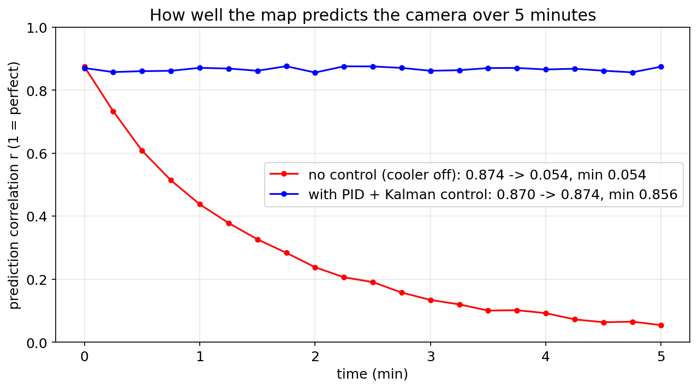
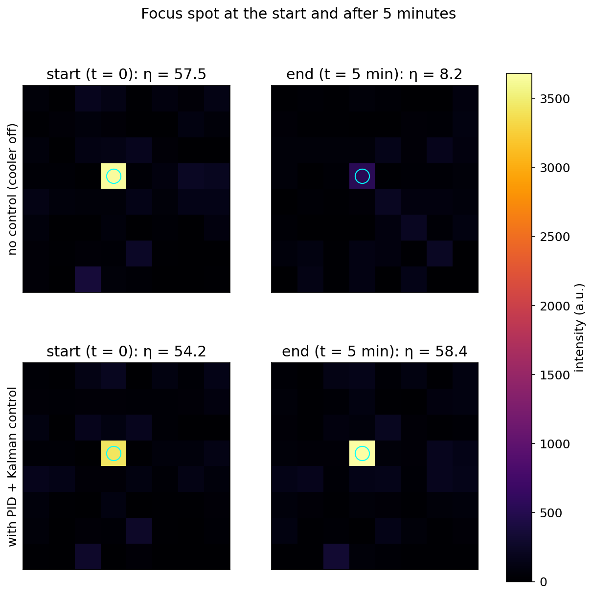

# Scattering-sample optics simulation

by Razmik Avagyan

Goal: a full simulation of the experiment as a base for AI agents that run and supervise it, later on the real setup.

This project simulates light passing through a phase-only SLM (N squares) and a strongly
scattering sample, with a camera recording intensities at M points. The sample is a random
complex transmission matrix X, using the row convention `E_out = E_in @ X`,
`(L x M) = (L x N) @ (N x M)`. The camera only sees `I = |E_out|**2`, so the generalized
Gerchberg-Saxton (GGS) algorithm recovers X from the known patterns and measured intensities.
The recovered map is then tested by focusing light through the sample and under temperature drift.

## Layout

- `config.py` — all numbers live in config.py: every tunable setting, one dict per module (`OPTICS`, `MAIN`, `DRIFT_TEST`, `THERMOSTAT`, `LAB_API`, `SCENARIO`, `BASELINE`, `STATE`, `AGENT_LOOP`), plus `TARGET_C`, with their sources.
- `optics_simulation/`
  - `lab.py` — the fake lab: random transmission matrix, 8-bit SLM patterns, SLM phase error, laser flicker, camera with noise/bit depth/saturation, temperature drift models, and `FakeLab`.
  - `ggs.py` — GGS recovery of X from E_in and amplitudes, with restarts for stuck columns (`recover`).
  - `metrics.py` — focusing enhancement vs. theory (`focus_test`), correlation with the true map (`map_quality`, simulation only), and lab-usable speckle correlations (`pearson`, `prediction_correlation`, `output_correlation`).
- `box_simulation/`
  - `thermostat.py` — the temperature-controlled box: lumped thermal model, BME280 sensor with noise and spikes, Kalman filter and PID as in Edgar's thermostat (`simulate`).
- `analysis/plots.py` — plotting functions only; each saves a PNG.
- `experiments/`
  - `main.py` — one full simulated experiment (fake lab → GGS → checks → plots and data, settings in `SETTINGS`).
  - `drift_test.py` — 5-minute temperature drift test with and without temperature control, using one map measured at t = 0; the box temperatures come from `box_simulation.thermostat`.
- `agents/`
  - `lab_api.py` — `LabAPI`, the one door the future agents use: wait, read the thermometer, set the box target or control, measure/check a map and focus, all on one lab clock with a log.
  - `scenario.py` — timed world events the operator cannot see (warmer room, cooler failure, new target), run by `LabAPI`; the self-test runs 2 hours with no operator and writes results/scenario/.
  - `baseline.py` — a simple operator with fixed rules ("never" re-measure vs. "rules": check the map every 5 min, re-measure below 0.8, warn when the box is off target), to compare the agents against later; writes results/baseline/.
  - `state.py` — `LabState`, the shared lab database (a local SQLite file, built-in `sqlite3`): runs, thermometer readings (never the true temperature), maps, focus photos, actions and notes, written by `LabAPI` and read by the agents.
  - `loop.py` — the agent loop Monitor → Diagnose → Plan → Act → Verify and a first Map agent with simple rules (re-measure only when the map is stale and the box is stable); `plan()` is the brain that an AI will replace; writes results/agents/.
- `results/` — generated plots and data.

## Running

Install: `pip install -r requirements.txt`. Run everything from the project root:

    python -m optics_simulation.lab        # self-test
    python -m optics_simulation.ggs        # self-test
    python -m optics_simulation.metrics    # self-test
    python -m box_simulation.thermostat    # self-test, writes results/thermostat/
    python -m analysis.plots               # self-test, temporary files only
    python -m experiments.main             # writes results/main/
    python -m experiments.drift_test       # writes results/drift_test/
    python -m agents.lab_api               # self-test, a short lab story (no files)
    python -m agents.scenario              # 2-hour scenario without operator, writes results/scenario/
    python -m agents.baseline              # fixed-rule operator vs. doing nothing, writes results/baseline/ and results/lab_state.sqlite
    python -m agents.state                 # self-test of the lab database (temporary file)
    python -m agents.loop                  # Map agent vs. never vs. rules, writes results/agents/

## Results

How well the map, measured once at t = 0, predicts the camera over 5 minutes, without and with temperature control:

The focus spot at the start and after 5 minutes, without and with temperature control:

The 2-hour scenario with no operator (the room warms, the cooler fails for 10 minutes, a new target):

Cooler power during the scenario, asked by the PID and really given:

