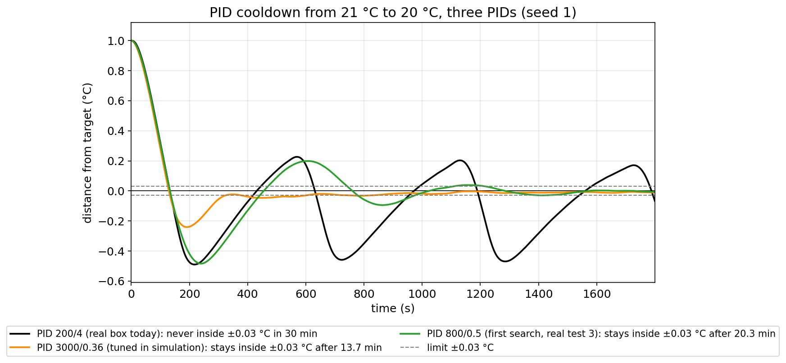
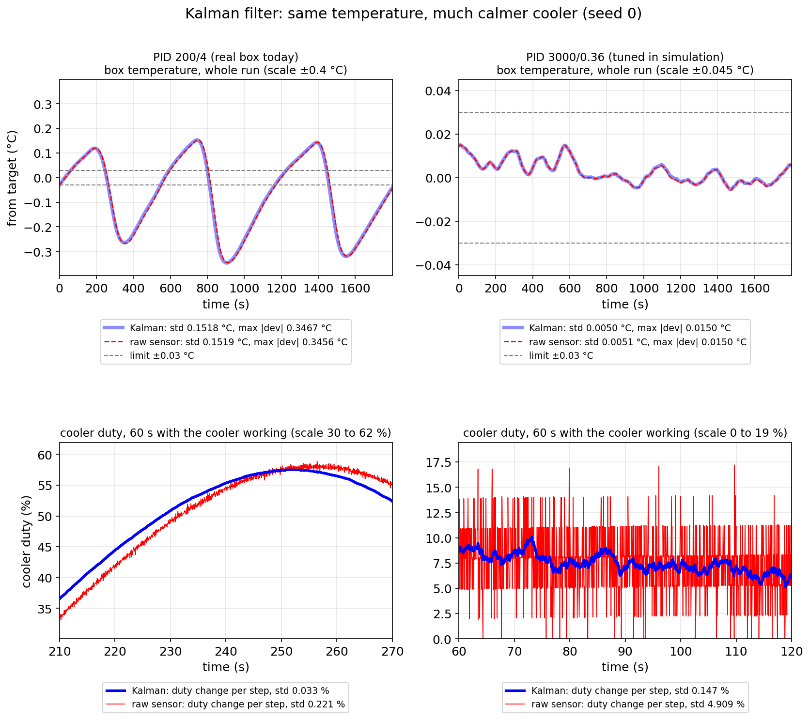
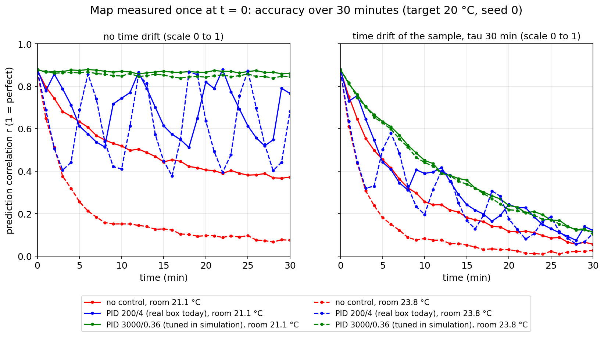
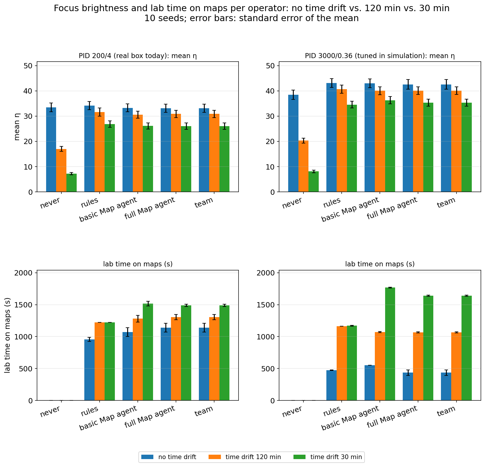
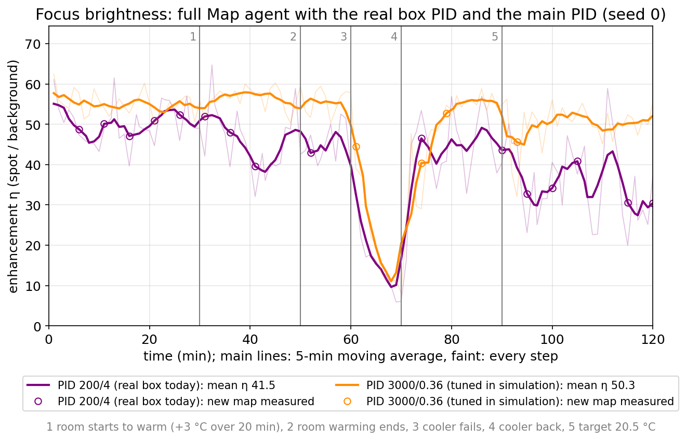
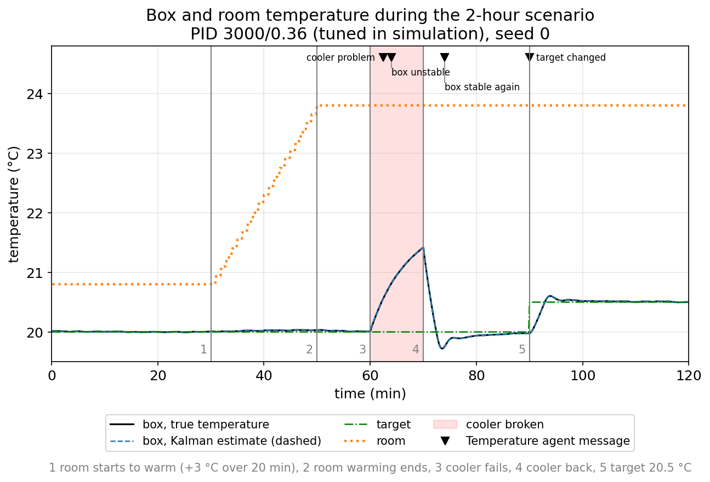

# Scientist report

Written 2026-11-25 11:55; rules brain (no AI). Every sentence cites its sources [S…] (listed at the end); every number in it was checked against them. Tables and plot paths are made by code from the same sources.

## What was simulated

- A phase-only SLM with N = 64 squares shapes light through a scattering sample seen by M = 64 camera points; GGS learns the sample's transmission matrix (the map) from 512 photos, and a fresh map predicts the camera with correlation 0.874. [S65, S64, S62, S63]
- The box is held at its target by a PID and a Kalman filter; in the two-hour scenario the room warms by 3 °C, the cooler fails for 10 min and the user asks for a new target of 20.5 °C. [S50, S48, S49]

## Thermostat

- With PID 200/4 (real box today) the box never stays inside ±0.03 °C after a step (it swings); in a hold its temperature std is 0.1518 °C. [S69, S70]
- With PID 3000/0.36 (tuned in simulation) the box stays inside ±0.03 °C 13.7 min after a target step; in a hold its temperature std is 0.0050 °C. [S69, S71, S74]
- With PID 800/0.5 (first search, real test 3) the box stays inside ±0.03 °C 20.3 min after a target step; in a hold its temperature std is 0.0111 °C. [S69, S76, S77]
- The Kalman filter hardly changes the box temperature (hold std 0.0050 vs. 0.0051 °C on the raw sensor with PID 3000/0.36 (tuned in simulation)), but the cooler is much calmer: the duty change per control step has a std of 0.147 % instead of 4.909 %. [S74, S75, S72, S73]
- Its readings are also more accurate: in the 30 min hold at 20 °C with PID 200/4 (real box today), the error std of the temperature reading is 0.0020 °C with the Kalman filter vs. 0.0167 °C for the raw sensor. [S67, S78, S66, S68]

## Optics and map staleness

- The analyst's fit of the map checks against the temperature change gives T_c = 1.67 °C for the exponential intensity model, close to the lab model's 1.6 °C; the Gaussian form gives 0.78 °C because the model is not Gaussian. [S1, S47, S2]
- Without time drift the sample comes back when the temperature comes back, so never re-measuring keeps a mean η of 33.5 with PID 200/4 (real box today); with time drift of 120 and 30 min it falls to 17.0 and 7.2. [S8, S54, S55, S22, S36]

## Operators compared

- Mean η and lab time on maps over 10 seeds are in the table below; a difference counts only beyond 2 standard errors of the paired seed differences. [S52, S51]

| operator | PID | time drift | mean η ± SE | lab time on maps (s) ± SE |
|---|---|---|---|---|
| never | PID 200/4 (real box today) | no time drift | 33.5 ± 1.7 | 0 ± 0 |
| fixed rules | PID 200/4 (real box today) | no time drift | 34.1 ± 1.7 | 958 ± 32 |
| basic Map agent | PID 200/4 (real box today) | no time drift | 33.3 ± 1.6 | 1072 ± 70 |
| full Map agent | PID 200/4 (real box today) | no time drift | 33.1 ± 1.6 | 1140 ± 69 |
| team | PID 200/4 (real box today) | no time drift | 33.1 ± 1.6 | 1140 ± 69 |
| never | PID 3000/0.36 (tuned in simulation) | no time drift | 38.4 ± 1.8 | 0 ± 0 |
| fixed rules | PID 3000/0.36 (tuned in simulation) | no time drift | 43.1 ± 1.8 | 474 ± 6 |
| basic Map agent | PID 3000/0.36 (tuned in simulation) | no time drift | 43.0 ± 1.7 | 552 ± 0 |
| full Map agent | PID 3000/0.36 (tuned in simulation) | no time drift | 42.5 ± 1.9 | 434 ± 43 |
| team | PID 3000/0.36 (tuned in simulation) | no time drift | 42.5 ± 1.9 | 434 ± 43 |
| never | PID 200/4 (real box today) | time drift 120 min | 17.0 ± 1.0 | 0 ± 0 |
| fixed rules | PID 200/4 (real box today) | time drift 120 min | 31.6 ± 1.6 | 1224 ± 0 |
| basic Map agent | PID 200/4 (real box today) | time drift 120 min | 30.6 ± 1.4 | 1280 ± 53 |
| full Map agent | PID 200/4 (real box today) | time drift 120 min | 30.9 ± 1.4 | 1306 ± 43 |
| team | PID 200/4 (real box today) | time drift 120 min | 30.9 ± 1.4 | 1306 ± 43 |
| never | PID 3000/0.36 (tuned in simulation) | time drift 120 min | 20.3 ± 1.0 | 0 ± 0 |
| fixed rules | PID 3000/0.36 (tuned in simulation) | time drift 120 min | 40.7 ± 1.6 | 1164 ± 0 |
| basic Map agent | PID 3000/0.36 (tuned in simulation) | time drift 120 min | 40.0 ± 1.5 | 1070 ± 10 |
| full Map agent | PID 3000/0.36 (tuned in simulation) | time drift 120 min | 40.1 ± 1.6 | 1064 ± 9 |
| team | PID 3000/0.36 (tuned in simulation) | time drift 120 min | 40.1 ± 1.6 | 1064 ± 9 |
| never | PID 200/4 (real box today) | time drift 30 min | 7.2 ± 0.5 | 0 ± 0 |
| fixed rules | PID 200/4 (real box today) | time drift 30 min | 26.8 ± 1.3 | 1224 ± 0 |
| basic Map agent | PID 200/4 (real box today) | time drift 30 min | 26.1 ± 1.3 | 1518 ± 37 |
| full Map agent | PID 200/4 (real box today) | time drift 30 min | 26.0 ± 1.2 | 1488 ± 19 |
| team | PID 200/4 (real box today) | time drift 30 min | 26.0 ± 1.2 | 1488 ± 19 |
| never | PID 3000/0.36 (tuned in simulation) | time drift 30 min | 8.1 ± 0.5 | 0 ± 0 |
| fixed rules | PID 3000/0.36 (tuned in simulation) | time drift 30 min | 34.5 ± 1.3 | 1170 ± 6 |
| basic Map agent | PID 3000/0.36 (tuned in simulation) | time drift 30 min | 36.3 ± 1.5 | 1769 ± 7 |
| full Map agent | PID 3000/0.36 (tuned in simulation) | time drift 30 min | 35.3 ± 1.4 | 1640 ± 9 |
| team | PID 3000/0.36 (tuned in simulation) | time drift 30 min | 35.3 ± 1.4 | 1640 ± 9 |

Sources of the table: results/compare/results*.csv (mean and standard error over the seeds).

## What the agents add, and where they do not

- Full Map agent minus fixed rules, PID 200/4 (real box today), no time drift: -1.0 ± 0.2 η (lower). [S5, S6]
- Full Map agent minus fixed rules, PID 3000/0.36 (tuned in simulation), no time drift: -0.5 ± 0.4 η (no clear difference). [S14, S15]
- Full Map agent minus fixed rules, PID 200/4 (real box today), time drift 120 min: -0.7 ± 0.3 η (lower). [S20, S21, S54]
- Full Map agent minus fixed rules, PID 3000/0.36 (tuned in simulation), time drift 120 min: -0.6 ± 0.1 η (lower). [S27, S28, S54]
- Full Map agent minus fixed rules, PID 200/4 (real box today), time drift 30 min: -0.8 ± 0.5 η (no clear difference). [S33, S35, S55]
- Full Map agent minus fixed rules, PID 3000/0.36 (tuned in simulation), time drift 30 min: +0.7 ± 0.2 η (higher). [S41, S42, S55]
- Basic Map agent minus fixed rules, PID 200/4 (real box today), no time drift: -0.9 ± 0.3 η (lower). [S3, S4]
- Basic Map agent minus fixed rules, PID 3000/0.36 (tuned in simulation), no time drift: -0.1 ± 0.1 η (no clear difference). [S12, S13]
- Basic Map agent minus fixed rules, PID 200/4 (real box today), time drift 120 min: -1.1 ± 0.4 η (lower). [S18, S19, S54]
- Basic Map agent minus fixed rules, PID 3000/0.36 (tuned in simulation), time drift 120 min: -0.6 ± 0.1 η (lower). [S25, S26, S54]
- Basic Map agent minus fixed rules, PID 200/4 (real box today), time drift 30 min: -0.7 ± 0.4 η (no clear difference). [S31, S32, S55]
- Basic Map agent minus fixed rules, PID 3000/0.36 (tuned in simulation), time drift 30 min: +1.7 ± 0.2 η (higher). [S39, S40, S55]
- The agents notice the cooler failure much sooner: the full Map agent reacts after 99 s on average, the fixed rules after 277 s (PID 200/4 (real box today), no time drift). [S7, S9]
- Their gain at time drift 30 min costs lab time: 1640 s on maps for the full Map agent vs. 1170 s for the fixed rules (PID 3000/0.36 (tuned in simulation)). [S43, S44, S55]
- The team gives exactly the full Map agent's numbers (difference +0.0 ± 0.0 η), because both use the same stability rule. [S16, S17]

## New experiments and their answers

- Question: Does the full Map agent beat the fixed rules at time drift 30 min with PID 200/4 (real box today)? With the saved 10 seeds the difference is -0.8 ± 0.5 η (no clear difference). [S34, S33, S35, S55]
- Answer: with 20 seeds (saved and new) the full Map agent minus the fixed rules is -0.8 ± 0.3 η, so lower. [S57, S56, S58]
- Question: At which time drift tau do the agents start to beat the fixed rules (PID 3000/0.36 (tuned in simulation))? Full Map agent minus fixed rules in η: no time drift -0.5 ± 0.4 (no clear difference); time drift 120 min -0.6 ± 0.1 (lower); time drift 60 min +0.5 ± 0.1 (higher); time drift 30 min +0.7 ± 0.2 (higher). [S14, S15, S27, S28, S54, S59, S60, S61, S41, S42, S55]
- Answer: the full Map agent beats the fixed rules (beyond the 2 standard errors) at time drift 60 and 30 min; without time drift there is no clear difference, at time drift 120 min it is lower. [S14, S15, S27, S28, S54, S59, S60, S61, S41, S42, S55, S51]
- Question: Does the team differ from the full Map agent? Answer: no; in every saved comparison the difference is exactly zero, seed by seed. [S10, S11, S16, S17, S23, S24, S29, S30, S37, S38, S45, S46]

Budget: 2 of 3 experiments, 40 runs, 6.0 of 40 min.
- experiment1: compare, operators rules, full, PID 200/4 (real box today), time drift 30 min, seeds 10–19
- experiment2: compare, operators rules, full, PID 3000/0.36 (tuned in simulation), time drift 60 min, seeds 0–9

## What must be measured on the real setup

- T_c of the real sample: the simulation assumes 1.6 °C (an estimate from the thesis drift curve); measure the map check against the temperature change on the real setup. [S47]
- Time drift of the real sample at a constant temperature: the comparison tried tau 120 and 30 min, and whether the agents help depends on it. [S54, S55]
- The PID and the Kalman filter on the real box: PID 200/4 (real box today) swings and never stays inside ±0.03 °C in the simulation; test PID 3000/0.36 (tuned in simulation) on the box, and the sensor noise (0.0103 °C from the real test) that the Kalman filter is tuned for. [S69, S53]

## Limitations

- Simulation only: no number here is measured on the real box (the real-box fit is in results/real_box/fit/).
- Brain: rules brain (no AI).

## Sources

- S1: `analysis/agents/full_map_agent_pid_200_4_fresh_level:map T_c exponential` = 1.66562
- S2: `analysis/agents/full_map_agent_pid_200_4_fresh_level:map T_c gaussian` = 0.777564
- S3: `compare/results.csv:PID 200/4 (real box today)|basic-rules|mean_eta.diff` = -0.883646
- S4: `compare/results.csv:PID 200/4 (real box today)|basic-rules|mean_eta.diff_se` = 0.343347
- S5: `compare/results.csv:PID 200/4 (real box today)|full-rules|mean_eta.diff` = -1.04278
- S6: `compare/results.csv:PID 200/4 (real box today)|full-rules|mean_eta.diff_se` = 0.239761
- S7: `compare/results.csv:PID 200/4 (real box today)|full|first_reaction_s.mean` = 99.4
- S8: `compare/results.csv:PID 200/4 (real box today)|never|mean_eta.mean` = 33.4513
- S9: `compare/results.csv:PID 200/4 (real box today)|rules|first_reaction_s.mean` = 277
- S10: `compare/results.csv:PID 200/4 (real box today)|team-full|mean_eta.diff` = 0
- S11: `compare/results.csv:PID 200/4 (real box today)|team-full|mean_eta.diff_se` = 0
- S12: `compare/results.csv:PID 3000/0.36 (tuned in simulation)|basic-rules|mean_eta.diff` = -0.115489
- S13: `compare/results.csv:PID 3000/0.36 (tuned in simulation)|basic-rules|mean_eta.diff_se` = 0.0940481
- S14: `compare/results.csv:PID 3000/0.36 (tuned in simulation)|full-rules|mean_eta.diff` = -0.544759
- S15: `compare/results.csv:PID 3000/0.36 (tuned in simulation)|full-rules|mean_eta.diff_se` = 0.386255
- S16: `compare/results.csv:PID 3000/0.36 (tuned in simulation)|team-full|mean_eta.diff` = 0
- S17: `compare/results.csv:PID 3000/0.36 (tuned in simulation)|team-full|mean_eta.diff_se` = 0
- S18: `compare/results_time_drift_120min.csv:PID 200/4 (real box today)|basic-rules|mean_eta.diff` = -1.05613
- S19: `compare/results_time_drift_120min.csv:PID 200/4 (real box today)|basic-rules|mean_eta.diff_se` = 0.447028
- S20: `compare/results_time_drift_120min.csv:PID 200/4 (real box today)|full-rules|mean_eta.diff` = -0.749682
- S21: `compare/results_time_drift_120min.csv:PID 200/4 (real box today)|full-rules|mean_eta.diff_se` = 0.346639
- S22: `compare/results_time_drift_120min.csv:PID 200/4 (real box today)|never|mean_eta.mean` = 17.0138
- S23: `compare/results_time_drift_120min.csv:PID 200/4 (real box today)|team-full|mean_eta.diff` = 0
- S24: `compare/results_time_drift_120min.csv:PID 200/4 (real box today)|team-full|mean_eta.diff_se` = 0
- S25: `compare/results_time_drift_120min.csv:PID 3000/0.36 (tuned in simulation)|basic-rules|mean_eta.diff` = -0.632642
- S26: `compare/results_time_drift_120min.csv:PID 3000/0.36 (tuned in simulation)|basic-rules|mean_eta.diff_se` = 0.124549
- S27: `compare/results_time_drift_120min.csv:PID 3000/0.36 (tuned in simulation)|full-rules|mean_eta.diff` = -0.5771
- S28: `compare/results_time_drift_120min.csv:PID 3000/0.36 (tuned in simulation)|full-rules|mean_eta.diff_se` = 0.129827
- S29: `compare/results_time_drift_120min.csv:PID 3000/0.36 (tuned in simulation)|team-full|mean_eta.diff` = 0
- S30: `compare/results_time_drift_120min.csv:PID 3000/0.36 (tuned in simulation)|team-full|mean_eta.diff_se` = 0
- S31: `compare/results_time_drift_30min.csv:PID 200/4 (real box today)|basic-rules|mean_eta.diff` = -0.716421
- S32: `compare/results_time_drift_30min.csv:PID 200/4 (real box today)|basic-rules|mean_eta.diff_se` = 0.396381
- S33: `compare/results_time_drift_30min.csv:PID 200/4 (real box today)|full-rules|mean_eta.diff` = -0.775501
- S34: `compare/results_time_drift_30min.csv:PID 200/4 (real box today)|full-rules|mean_eta.diff_n` = 10
- S35: `compare/results_time_drift_30min.csv:PID 200/4 (real box today)|full-rules|mean_eta.diff_se` = 0.454283
- S36: `compare/results_time_drift_30min.csv:PID 200/4 (real box today)|never|mean_eta.mean` = 7.22691
- S37: `compare/results_time_drift_30min.csv:PID 200/4 (real box today)|team-full|mean_eta.diff` = 0
- S38: `compare/results_time_drift_30min.csv:PID 200/4 (real box today)|team-full|mean_eta.diff_se` = 0
- S39: `compare/results_time_drift_30min.csv:PID 3000/0.36 (tuned in simulation)|basic-rules|mean_eta.diff` = 1.73006
- S40: `compare/results_time_drift_30min.csv:PID 3000/0.36 (tuned in simulation)|basic-rules|mean_eta.diff_se` = 0.215521
- S41: `compare/results_time_drift_30min.csv:PID 3000/0.36 (tuned in simulation)|full-rules|mean_eta.diff` = 0.743108
- S42: `compare/results_time_drift_30min.csv:PID 3000/0.36 (tuned in simulation)|full-rules|mean_eta.diff_se` = 0.172024
- S43: `compare/results_time_drift_30min.csv:PID 3000/0.36 (tuned in simulation)|full|lab_time_on_maps_s.mean` = 1640.4
- S44: `compare/results_time_drift_30min.csv:PID 3000/0.36 (tuned in simulation)|rules|lab_time_on_maps_s.mean` = 1170
- S45: `compare/results_time_drift_30min.csv:PID 3000/0.36 (tuned in simulation)|team-full|mean_eta.diff` = 0
- S46: `compare/results_time_drift_30min.csv:PID 3000/0.36 (tuned in simulation)|team-full|mean_eta.diff_se` = 0
- S47: `config.py:T_c` = 1.6
- S48: `config.py:cooler_fail_for_s` = 600
- S49: `config.py:new_target_C` = 20.5
- S50: `config.py:room_warm_by_C` = 3
- S51: `config.py:se_factor` = 2
- S52: `config.py:seeds` = 10
- S53: `config.py:sensor_std` = 0.0103
- S54: `config.py:time_drift_taus[0]` = 120
- S55: `config.py:time_drift_taus[1]` = 30
- S56: `experiment1+saved:PID 200/4 (real box today)|full-rules|mean_eta.diff` = -0.799467
- S57: `experiment1+saved:PID 200/4 (real box today)|full-rules|mean_eta.diff_n` = 20
- S58: `experiment1+saved:PID 200/4 (real box today)|full-rules|mean_eta.diff_se` = 0.285415
- S59: `experiment2:PID 3000/0.36 (tuned in simulation)|full-rules|mean_eta.diff` = 0.511777
- S60: `experiment2:PID 3000/0.36 (tuned in simulation)|full-rules|mean_eta.diff_se` = 0.144663
- S61: `experiment2:tau` = 60
- S62: `main/summary.json:results.L` = 512
- S63: `main/summary.json:results.prediction_correlation` = 0.874224
- S64: `main/summary.json:settings.M` = 64
- S65: `main/summary.json:settings.N` = 64
- S66: `thermostat/summary.json:kalman_error_std_C.Kalman` = 0.00199262
- S67: `thermostat/summary.json:kalman_error_std_C.hold_s` = 1800
- S68: `thermostat/summary.json:kalman_error_std_C.raw sensor` = 0.0167395
- S69: `thermostat/summary.json:limit_C` = 0.03
- S70: `thermostat/summary.json:pids.PID 200/4 (real box today).hold_std_C.Kalman` = 0.151762
- S71: `thermostat/summary.json:pids.PID 3000/0.36 (tuned in simulation).cooldown_inside_limit_s` = 820.9
- S72: `thermostat/summary.json:pids.PID 3000/0.36 (tuned in simulation).duty_change_std_pct.Kalman` = 0.147348
- S73: `thermostat/summary.json:pids.PID 3000/0.36 (tuned in simulation).duty_change_std_pct.raw sensor` = 4.90945
- S74: `thermostat/summary.json:pids.PID 3000/0.36 (tuned in simulation).hold_std_C.Kalman` = 0.00503877
- S75: `thermostat/summary.json:pids.PID 3000/0.36 (tuned in simulation).hold_std_C.raw sensor` = 0.00509243
- S76: `thermostat/summary.json:pids.PID 800/0.5 (first search, real test 3).cooldown_inside_limit_s` = 1217.45
- S77: `thermostat/summary.json:pids.PID 800/0.5 (first search, real test 3).hold_std_C.Kalman` = 0.0111206
- S78: `thermostat/summary.json:target_C` = 20
